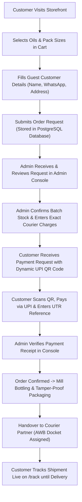
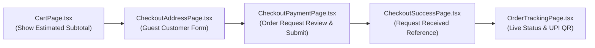
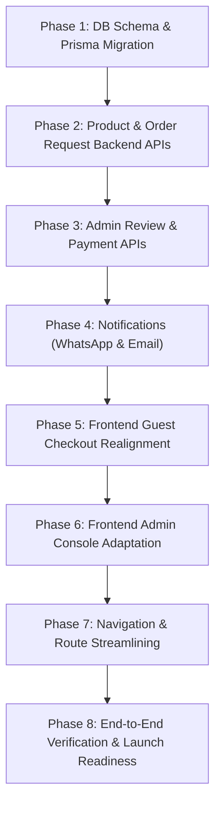

# SSK Natural Gold — Architecture Audit & Workflow Migration Plan

**Document Title**: System Architecture Audit, Codebase Inventory & Workflow Migration Specification  
**Project**: SSK Natural Gold (Startup Retail Wood-Pressed Edible Oil Business)  
**Role**: Senior Full-Stack Software Architect & Technical Lead  
**Audit Date**: November 10, 2026  
**Status**: Completed Read-Only Audit & Execution Blueprint  

---

## 1. Executive Summary

### 1.1 Context & Business Pivot
**SSK Natural Gold** is an enterprise-quality e-commerce platform built for a startup retail edible oil enterprise headquartered in Tenkasi, Tamil Nadu. The company extracts and distributes three core varieties of unrefined, traditional wood-pressed (*Vaagai Marachekku*) oils:
1. **Traditional Groundnut Oil** (*மரச்செக்கு கடலை எண்ணெய்*)
2. **Pure Wood-Pressed Sesame Oil with Authentic Palm Jaggery** (*மரச்செக்கு நல்லெண்ணெய் - கருப்பட்டி*)
3. **Unrefined Cold-Pressed Coconut Oil** (*மரச்செக்கு தேங்காய் எண்ணெய்*)

The repository was initially designed with a standard full-scale e-commerce architecture (user registration, SMS OTP verification, simulated credit card/net-banking payment gateways, and personal account dashboards). However, operational realities for a boutique agricultural startup favor a **lightweight, request-based purchasing workflow**:

$$\text{Homepage} \longrightarrow \text{Product Catalogue} \longrightarrow \text{Product Details} \longrightarrow \text{Cart} \longrightarrow \text{Customer Details} \longrightarrow \text{Submit Order Request} \longrightarrow \text{Admin Reviews Request} \longrightarrow \text{Admin Confirms Availability \& Amount} \longrightarrow \text{Customer Pays via UPI QR} \longrightarrow \text{Admin Verifies Payment} \longrightarrow \text{Order Confirmation} \longrightarrow \text{Courier Dispatch} \longrightarrow \text{Delivery}$$



### 1.2 Core Business Requirements
- **No Mandatory Customer Registration**: Frictionless guest checkout.
- **No Initial Payment Gateway SDK**: Zero payment gateway transaction fees (bypassing Razorpay/Stripe compliance and setup delays).
- **UPI QR-Based Manual Payment**: Direct merchant account transfers via standard NPCI UPI Intent strings.
- **Manual Payment Verification**: Administrator matches incoming UPI UTR / bank credit alert before order confirmation.
- **WhatsApp & Email Communication**: Transactional updates dispatched at key milestones.
- **Manual Courier Management**: Administrator selects regional courier (e.g., The Professional Couriers, ST Courier, India Post) and assigns AWB docket numbers.
- **Streamlined Status Pipeline**: `REQUEST_SUBMITTED` $\rightarrow$ `PAYMENT_PENDING` $\rightarrow$ `PAYMENT_SUBMITTED` $\rightarrow$ `ORDER_CONFIRMED` $\rightarrow$ `PROCESSING_PACKING` $\rightarrow$ `DISPATCHED` $\rightarrow$ `DELIVERED`.
- **Database Persistence Prerequisite**: Every order request must be committed to PostgreSQL before notifications are triggered.

### 1.3 Key Audit Findings
| Dimension | Verified State | Audit Finding | Strategic Recommendation |
| :--- | :--- | :--- | :--- |
| **Frontend SPA** | React 18, Vite 6, Tailwind CSS 3.4 | 100% buildable (`tsc && vite build` clean). 27 page components, 43 routes. | **Retain & Simplify**. Keep presentation layer; eliminate login screens and account dashboards from main navigation. |
| **Global Stores** | 4 Zustand stores | `useAppStore` & `useCartStore` persist to `localStorage`. Pre-seeded cart items exist. | **Modify**. Clear pre-seeded cart items; adjust stores to hold guest session data. |
| **Backend API** | Node.js, Express, TypeScript | Only 1 endpoint implemented: `GET /api/health`. Controllers and services do not exist. | **Construct**. Implement clean request-handling controllers and notification services. |
| **Database & ORM** | PostgreSQL, Prisma ORM 6.3.1 | `schema.prisma` has 0 models; 0 migrations run. | **Pristine Slate**. Define dedicated `OrderRequest`, `Product`, and `AdminUser` models directly. |

---

## 2. Verified Frontend Structure

### 2.1 File & Directory Inspection
The client-side single page application is located under `frontend/src/`:
- **`assets/`**: Master brand logo (`logo.png`), bottle pack images (`0.jpeg` to `9.jpeg`), and production harvest photography.
- **`components/common/`**: 17 reusable UI primitives (`Button`, `Modal`, `Dialog`, `ConfirmationDialog`, `Badge`, `Input`, `Select`, `Checkbox`, `Radio`, `Toast`, `LoadingSpinner`, `SkeletonLoader`, `EmptyState`, `ErrorState`, `LanguageSwitcher`, `Icons`).
- **`components/layout/`**: 10 responsive shell wrappers (`CustomerHeader`, `CustomerFooter`, `CustomerLayout`, `AdminHeader`, `AdminSidebar`, `AdminLayout`, `MobileBottomNavigation`, `AuthLayout`, `MainLayout`, `PageContainer`).
- **`components/product/`**: 6 domain-specific product components (`ProductCard`, `ProductImage`, `PriceDisplay`, `QuantitySelector`, `RatingDisplay`, `StockStatus`).
- **`lib/`**: Axios client configured with `baseURL: http://localhost:5000/api` and 10s timeout; TanStack Query client.
- **`mock/`**: Static datasets for products, addresses, simulated orders, users, and admin KPI metrics.
- **`pages/`**: 27 page view components.
- **`routes/AppRoutes.tsx`**: Central route manifest.
- **`stores/`**: Zustand state stores (`useAppStore`, `useCartStore`, `useLanguageStore`, `useToastStore`).

### 2.2 Route Inventory & Action Classification
Every route declared in `AppRoutes.tsx` has been verified and classified:

| Route Path(s) | View Component | Original Scope | Target Classification | Required Action |
| :--- | :--- | :--- | :--- | :--- |
| `/`, `/home` | `HomePage.tsx` | Storefront landing, banners, oil benefits, FAQ | **Keep with modifications** | Connect "Add to Cart" directly to `useCartStore`; align pack prices with catalog. |
| `/shop`, `/products` | `ShopAllPage.tsx` | Full catalog, category filters, price sorting | **Keep unchanged** | Fully functional; seamlessly updates `useCartStore`. |
| `/products/:slug`, `/product/:slug` | `ProductDetailPage.tsx` | Deep product storytelling, pack pills, pincode lookup | **Keep with modifications** | Point "Buy Now" button directly to the guest checkout form. |
| `/cart` | `CartPage.tsx` | Harvest basket, promo code engine, delivery fee | **Simplify** | Remove pre-seeded items; display estimated subtotal; update CTA to "Proceed to Customer Details". |
| `/checkout`, `/checkout/address` | `CheckoutAddressPage.tsx` | Multi-address selector for logged-in user | **Keep with modifications** | Transform into **Guest Customer Details & Address Form**. |
| `/checkout/payment` | `CheckoutPaymentPage.tsx` | Gateway simulator (Cards, NetBanking, instant UPI, COD) | **Remove / Transform** | Transform into **Order Request Review & Submit** stage. |
| `/checkout/success` | `CheckoutSuccessPage.tsx` | Immediate order confirmation | **Keep with modifications** | Update copy to "Order Request Received"; display reference number and timeline. |
| `/orders/:orderId`, `/track` | `OrderTrackingPage.tsx` | Vertical 5-checkpoint timeline from mill to home | **Keep with modifications** | Make accessible via Reference # + Phone lookup; embed dynamic UPI QR display. |
| `/login` | `LoginPage.tsx` | Customer authentication | **Defer for future development** | Unhook from header and navigation. |
| `/register` | `RegisterPage.tsx` | Customer registration | **Defer for future development** | Unhook from header and navigation. |
| `/verify-otp` | `OtpVerificationPage.tsx` | 6-digit SMS OTP entry | **Defer for future development** | Unhook from navigation. |
| `/forgot-password`, `/reset-password` | Password recovery views | Password reset flow | **Defer for future development** | Unhook from navigation. |
| `/account` | `AccountDashboardPage.tsx` | Profile and active order widget | **Defer for future development** | Unhook from navigation. |
| `/account/orders` | `OrderHistoryPage.tsx` | Customer past orders list | **Defer for future development** | Unhook from navigation. |
| `/about`, `/faq` | `AboutUsPage.tsx` | Vaagai wood story, FSSAI info, FAQs | **Keep unchanged** | High-quality bilingual copy ready for production. |
| `/contact`, `/wholesale` | `ContactWholesalePage.tsx` | B2B lead form, WhatsApp direct link | **Keep unchanged** | Lead capture is fully functional. |
| `/policies`, `/terms`, `/privacy`, `/returns`, `/shipping` | `PoliciesLegalPage.tsx` | Legal and compliance hub | **Keep with modifications** | Update return/shipping terms to reflect manual UPI verification policy. |
| `/design-system`, `/showcase` | `ComponentShowcase.tsx` | Design system component gallery | **Keep unchanged** | Useful internal developer reference. |
| `/admin/login` | `AdminLoginPage.tsx` | Admin console sign-in | **Keep with modifications** | Connect to backend `POST /api/admin/auth/login`. |
| `/admin`, `/admin/dashboard` | `AdminDashboardPage.tsx` | Mill operations overview | **Keep with modifications** | Realignment of KPI metrics to order request pipeline. |
| `/admin/orders` | `AdminOrdersPage.tsx` | Order dispatch list | **Keep with modifications** | Transform into **Admin Request & Fulfillment Desk**. |
| `/admin/products`, `.../products/new`, `.../products/:id` | `AdminProductsPage.tsx`, `AdminProductStudioPage.tsx` | Product management and SKU editor | **Keep with modifications** | Connect to database product endpoints. |
| `/admin/pricing`, `.../pricing/audit` | `AdminPricingPage.tsx`, `AdminPriceAuditPage.tsx` | Margin calculator & audit trail | **Defer for future development** | Secondary for initial launch. |
| `/admin/safeguards` | `AdminSafeguardsPage.tsx` | Destructive action confirmation guardrails | **Defer for future development** | UI demonstration; unhook from sidebar. |
| `*` | `NotFoundPage.tsx` | 404 Catch-All | **Keep unchanged** | Clean branded error view. |

### 2.3 Zustand State Stores Audit
1. **`useAppStore` (`ssk_app_storage`)**:
   - Currently initializes `currentUser: MOCK_CUSTOMER` and `addresses: [...MOCK_ADDRESSES]`.
   - *Audit finding*: Causes the application to load in a mock authenticated state.
   - *Adjustment*: Default `currentUser` to `null`; add a clean `guestDetails` object.
2. **`useCartStore` (`ssk_cart_storage`)**:
   - Currently pre-seeds 2 items (Groundnut 500ml and Sesame 500ml).
   - *Audit finding*: Any fresh user visit begins with items already placed in the cart.
   - *Adjustment*: Initialize with `items: []`. Retain quantity manipulation and subtotal calculations.
3. **`useLanguageStore`**:
   - Manages instant bilingual toggle between English (`en`) and Tamil (`ta`).
   - *Audit finding*: Clean, zero-dependency, reactive store. Retain unchanged.
4. **`useToastStore`**:
   - Manages transient, self-dismissing notification toasts.
   - *Audit finding*: Production-ready. Retain unchanged.

---

## 3. Verified Backend Structure

### 3.1 Codebase Inventory
The backend located under `backend/src/` currently comprises:
```
backend/
├── prisma/
│   └── schema.prisma          # Only generator and postgresql datasource (0 models)
├── src/
│   ├── config/
│   │   ├── database.ts        # PrismaClient singleton instance
│   │   └── env.ts             # Dotenv environment configuration
│   ├── middlewares/
│   │   ├── errorHandler.ts    # Global error handler
│   │   └── notFound.ts        # 404 handler
│   ├── routes/
│   │   ├── health.routes.ts   # GET /api/health implementation
│   │   └── index.ts           # Root router registering /health
│   ├── app.ts                 # Express application initialization and middleware chain
│   └── server.ts              # HTTP server listener and graceful shutdown
├── .env.example               # Template environment configuration
├── package.json               # Backend dependencies
└── tsconfig.json              # TypeScript configuration
```

### 3.2 Implementation Status vs. Scaffold Analysis
- **Express Core**: Fully functional. Properly handles CORS (`origin: config.clientUrl`, `credentials: true`), JSON parsing, URL encoding, and signals (`SIGTERM`, `SIGINT`).
- **API Routes**: Only `GET /` and `GET /api/health` are implemented. No routes exist for products, orders, authentication, or notifications.
- **Modular Layers**: Directories `controllers/`, `services/`, `utils/`, and `types/` are absent.
- **Authentication**: Zero authentication middleware or password hashing logic exists.
- **Database Layer**: `schema.prisma` contains zero models. No Prisma migrations have been run.

---

## 4. Existing Functionality That Can Be Reused

The following assets represent substantial existing engineering value that will be preserved:

1. **Rich Botanical & Cultural Domain Data**:
   - Complete specifications for Groundnut, Sesame, and Coconut oils in `src/mock/products.ts`.
   - Includes authentic details: FSSAI License `22426293000431`, botanical names, cold extraction temperature limits (< 42°C), Vaagai wood specifications, and full Tamil translations.
2. **Bilingual Localization Engine**:
   - Seamless toggling between English and Tamil across all screens, navigation menus, and form labels.
3. **Reusable Design System**:
   - 17 common components and 6 product presentation components built with Tailwind CSS.
4. **Cart Management Logic**:
   - Zustand-based cart state machine supporting addition, variant switching, quantity updates, and subtotal calculation.
5. **Responsive Layout Shells**:
   - Desktop and mobile headers, mobile bottom tab navigation, and full admin console layout.
6. **Backend Server Baseline**:
   - Express 4.x setup with CORS, error handling, environment parsing, and Prisma client singleton.

---

## 5. Screens and Features That Need Modification



### Detailed Modifications Required
1. **`HomePage.tsx`**:
   - Rebind the quick-add buttons on the product cards to `useCartStore.addItem()` instead of the isolated `useState(3)`.
2. **`CartPage.tsx`**:
   - Clear pre-seeded items. Change price breakdown to show **Estimated Subtotal**. Add notice that courier charges are confirmed based on destination pincode. Change CTA to *"Proceed to Customer Details"*.
3. **`CheckoutAddressPage.tsx`**:
   - Convert into a dedicated **Guest Customer Details & Address Form**:
     - Customer Full Name
     - Primary WhatsApp Mobile Number (mandatory for payment QR)
     - Email Address (optional / for receipts)
     - Delivery Street Address & Landmark
     - City / Town & 6-Digit PIN Code
     - Delivery Notes (e.g., preferred delivery hours)
4. **`CheckoutPaymentPage.tsx` $\longrightarrow$ Order Request Review**:
   - Replace payment gateway options with an **Order Request Review & Submit Screen**:
     - Summarizes selected oil bottles and estimated subtotal.
     - Informs the customer: *"No payment is required right now. Our mill team will verify fresh batch stock and calculate exact courier charges, then send your confirmed total and UPI QR code directly on WhatsApp."*
     - Button: *"Submit Order Request"*.
5. **`CheckoutSuccessPage.tsx`**:
   - Change heading to *"Order Request Received!"*.
   - Prominently display the generated **Unique Request Reference** (e.g., `SSK-REQ-2026-1042`).
   - Display a 3-step timeline: Request Received $\rightarrow$ Mill Stock & Courier Review $\rightarrow$ UPI QR Payment & Dispatch.
6. **`OrderTrackingPage.tsx`**:
   - Connect to `GET /api/orders/track/:reference`. Add lookup by Reference # and Phone Number.
   - When status reaches `PAYMENT_PENDING`, display the dynamic **UPI QR Code**, payable amount, and a submission box for the customer's UPI UTR / Transaction ID.
7. **`CustomerHeader.tsx` & `MobileBottomNavigation.tsx`**:
   - Point the account icon and 4th mobile tab to `/track` (Track Order) instead of `/account`.
8. **`AdminOrdersPage.tsx`**:
   - Re-architect into the **Admin Request & Fulfillment Desk**:
     - Status tabs: `New Requests`, `Awaiting Payment`, `Payment Verification`, `Confirmed & Packing`, `Dispatched`, `Delivered`.
     - Request Review Modal: view customer items, input **Courier & Handling Fee** (INR), click *"Confirm Availability & Send Payment QR"*.
     - Payment Verification: view customer's submitted UTR, click *"Mark Payment Verified"*.
     - Courier Dispatch: enter **Courier Partner Name** and **AWB Tracking Docket**, click *"Dispatch & Notify Customer"*.

---

## 6. Features That Can Be Deferred

To maintain a lean implementation, the following features will be deferred:
1. **Customer Authentication Suite** (`LoginPage`, `RegisterPage`, `OtpVerificationPage`, `ForgotPasswordPage`, `ResetPasswordPage`): Retain files in codebase, but unhook all entry points from active navigation.
2. **Customer Account Dashboard & Order History** (`AccountDashboardPage`, `OrderHistoryPage`): Replaced by public guest tracking on `/track`.
3. **Automated Payment Gateway Integration**: Replaced by UPI QR and administrator verification.
4. **Dynamic Price Margin Simulator** (`AdminPricingPage`, `AdminPriceAuditPage`): Retail prices can be edited directly in product administration.
5. **Administrative Safeguards Demonstration** (`AdminSafeguardsPage`): Secondary mock demonstration; unhook from admin sidebar.
6. **Promotional Coupon Engine**: Discounts can be applied directly by the administrator during order review.

---

## 7. Missing Backend Functionality

The following modular services and endpoints must be implemented under `backend/src/`:

```
backend/src/
├── controllers/
│   ├── adminAuth.controller.ts     # Admin sign-in / session management
│   ├── adminOrder.controller.ts    # Request review, pricing adjustment, dispatch
│   ├── orderRequest.controller.ts  # Guest order request creation & tracking lookup
│   └── product.controller.ts       # Public catalogue retrieval
├── services/
│   ├── email.service.ts            # Transactional email dispatcher (Nodemailer)
│   ├── notification.service.ts     # Central notification coordinator (Email + WhatsApp)
│   ├── order.service.ts            # Order calculations, price validation, status transitions
│   ├── upi.service.ts              # Dynamic UPI payment URI and QR code generation
│   └── whatsapp.service.ts         # WhatsApp notification triggers / deep links
├── routes/
│   ├── admin.routes.ts             # Protected /api/admin/* endpoints
│   ├── order.routes.ts             # Public /api/orders/* endpoints
│   └── product.routes.ts           # Public /api/products/* endpoints
├── utils/
│   ├── orderReference.ts           # Collision-resistant human-readable order IDs
│   └── validators.ts               # Input validation for Indian phone numbers and pincodes
```

### Complete API Specification
- **Storefront Endpoints**:
  - `GET /api/products`: Retrieve all active products and pack variants.
  - `GET /api/products/:slug`: Retrieve single product details.
  - `POST /api/orders/request`: Create guest order request (validating product prices against database, saving to PostgreSQL before any notification trigger).
  - `GET /api/orders/track/:reference`: Look up order status by reference number and customer phone.
  - `POST /api/orders/:reference/payment-submit`: Record customer's UPI UTR / transaction reference number.
- **Admin Console Endpoints**:
  - `POST /api/admin/auth/login`: Admin sign-in and session token generation.
  - `GET /api/admin/orders`: List all order requests with status filtering.
  - `GET /api/admin/orders/:id`: Comprehensive view of an order request.
  - `PUT /api/admin/orders/:id/confirm`: Set courier fee, confirm stock availability, generate UPI QR, transition to `PAYMENT_PENDING`, and trigger payment notification.
  - `PUT /api/admin/orders/:id/verify-payment`: Verify payment receipt, transition to `ORDER_CONFIRMED`, and trigger confirmation notification.
  - `PUT /api/admin/orders/:id/dispatch`: Record courier name and AWB docket number, transition to `DISPATCHED`, and trigger dispatch notification.
  - `PUT /api/admin/orders/:id/status`: Generic status updates (`DELIVERED`, `CANCELLED`).
  - `GET /api/admin/metrics`: Dashboard metrics for pending requests, dispatches, and completions.

---

## 8. Database Readiness

### Prisma Schema Design
The following relational model will be implemented in `backend/prisma/schema.prisma`:

```prisma
datasource db {
  provider = "postgresql"
  url      = env("DATABASE_URL")
}

generator client {
  provider = "prisma-client-js"
}

enum OrderStatus {
  REQUEST_SUBMITTED     // Initial customer request
  PAYMENT_PENDING       // Admin confirmed stock & courier fee, sent UPI QR
  PAYMENT_SUBMITTED     // Customer submitted UPI UTR / reference number
  ORDER_CONFIRMED       // Admin verified payment
  PROCESSING_PACKING    // Bottling and packaging at Tenkasi mill
  DISPATCHED            // Handed to courier with AWB docket
  DELIVERED             // Delivered to customer doorstep
  CANCELLED             // Cancelled or out of stock
}

model Product {
  id                  String           @id @default(cuid())
  slug                String           @unique
  category            String           // "groundnut" | "sesame" | "coconut"
  name                String
  nameTa              String
  botanicalName       String
  tagline             String
  taglineTa           String
  description         String
  descriptionTa       String
  extractionProcess   String
  extractionProcessTa String
  woodType            String           // "Vaagai Wood Mortar"
  fssaiLicense        String
  primaryImage        String
  featured            Boolean          @default(false)
  inStock             Boolean          @default(true)
  variants            ProductVariant[]
  createdAt           DateTime         @default(now())
  updatedAt           DateTime         @updatedAt
}

model ProductVariant {
  id            String      @id @default(cuid())
  productId     String
  product       Product     @relation(fields: [productId], references: [id], onDelete: Cascade)
  sku           String      @unique
  volume        String      // "500 ml", "1 Litre", "5 L Tin", "15 L Tin"
  volumeMl      Int
  containerType String
  mrp           Decimal     @db.Decimal(10, 2)
  price         Decimal     @db.Decimal(10, 2)
  stock         Int         @default(0)
  isDefault     Boolean     @default(false)
  orderItems    OrderItem[]
}

model OrderRequest {
  id                    String           @id @default(cuid())
  orderReference        String           @unique // e.g. "SSK-REQ-2026-1042"
  status                OrderStatus      @default(REQUEST_SUBMITTED)
  
  // Guest Customer Details
  customerName          String
  customerPhone         String           // WhatsApp mobile number
  customerEmail         String?
  addressLine1          String
  addressLine2          String?
  landmark              String?
  city                  String
  state                 String           @default("Tamil Nadu")
  pincode               String
  deliveryInstructions  String?

  // Financials & Calculations
  estimatedSubtotal     Decimal          @db.Decimal(10, 2)
  courierFee            Decimal?         @db.Decimal(10, 2)
  discountAmount        Decimal          @default(0) @db.Decimal(10, 2)
  finalPayableAmount    Decimal?         @db.Decimal(10, 2)

  // Payment Tracking (Manual UPI QR)
  upiVpa                String?          // Destination UPI VPA
  customerUtrNumber     String?          // UTR / Transaction ID submitted by customer
  paymentVerifiedAt     DateTime?
  paymentNotes          String?

  // Fulfillment & Courier Logistics
  courierPartner        String?          // e.g. "The Professional Couriers", "ST Courier"
  awbNumber             String?          // Courier tracking number
  dispatchedAt          DateTime?
  deliveredAt           DateTime?

  items                 OrderItem[]
  statusHistory         OrderStatusLog[]

  createdAt             DateTime         @default(now())
  updatedAt             DateTime         @updatedAt

  @@index([customerPhone])
  @@index([orderReference])
  @@index([status])
}

model OrderItem {
  id             String         @id @default(cuid())
  orderRequestId String
  orderRequest   OrderRequest   @relation(fields: [orderRequestId], references: [id], onDelete: Cascade)
  variantId      String
  variant        ProductVariant @relation(fields: [variantId], references: [id])
  productName    String
  volumeLabel    String
  unitPrice      Decimal        @db.Decimal(10, 2)
  quantity       Int
  totalPrice     Decimal        @db.Decimal(10, 2)
}

model OrderStatusLog {
  id             String       @id @default(cuid())
  orderRequestId String
  orderRequest   OrderRequest @relation(fields: [orderRequestId], references: [id], onDelete: Cascade)
  status         OrderStatus
  note           String?
  createdByName  String?      // Admin name or "Customer" or "System"
  createdAt      DateTime     @default(now())
}

model AdminUser {
  id           String   @id @default(cuid())
  email        String   @unique
  name         String
  passwordHash String
  isActive     Boolean  @default(true)
  createdAt    DateTime @default(now())
  updatedAt    DateTime @updatedAt
}
```

---

## 9. Security and Business Logic Concerns

1. **Server-Side Price Validation**:
   - The backend `POST /api/orders/request` endpoint must recalculate subtotals exclusively from database `ProductVariant.price` values, completely ignoring any price figures submitted by the client browser.
2. **Order Persistence Before Notification Trigger**:
   - Order records must be committed to PostgreSQL within a database transaction before notification tasks are enqueued. Notification failures must not invalidate the saved order.
3. **Guest Order Privacy on `/track`**:
   - To prevent order enumeration, `GET /api/orders/track/:reference` requires the customer's registered phone number to return shipping address details.
4. **Duplicate UPI UTR Prevention**:
   - Incoming UTR numbers will be checked for uniqueness across existing confirmed orders to prevent reuse of payment receipts.
5. **Input Sanitation & Rate Limiting**:
   - Strict regex validation for Indian 10-digit mobile numbers (`/^[6-9]\d{9}$/`) and 6-digit postal codes (`/^\d{6}$/`).
   - Rate limiting applied to public request submission endpoints to prevent automated spam.
6. **Admin Route Security**:
   - Admin endpoints secured with JWT tokens or session cookies; passwords securely hashed with `bcrypt`.

---

## 10. File-by-File Migration Plan

| File / Module | Current Functionality | Required Modification | Reason for Modification | Dependencies | Risk Level |
| :--- | :--- | :--- | :--- | :--- | :--- |
| `backend/prisma/schema.prisma` | Empty schema (0 models) | Add models: `Product`, `ProductVariant`, `OrderRequest`, `OrderItem`, `OrderStatusLog`, `AdminUser` | Database foundation for the request-based workflow | PostgreSQL | Low |
| `backend/src/routes/product.routes.ts` | Non-existent | Implement `GET /api/products` and `GET /api/products/:slug` | Provide product data from database | Prisma | Low |
| `backend/src/routes/order.routes.ts` | Non-existent | Implement `POST /api/orders/request`, `GET /api/orders/track/:reference`, `POST /api/orders/:reference/payment-submit` | Enable guest order request submission and tracking | Prisma, Validators | Medium |
| `backend/src/routes/admin.routes.ts` | Non-existent | Implement admin order review, shipping fee entry, payment verification, and dispatch endpoints | Power the admin fulfillment desk | Prisma, Auth middleware | Medium |
| `backend/src/services/notification.service.ts` | Non-existent | Implement WhatsApp message links and Nodemailer transactional emails | Customer notification delivery | Nodemailer / WhatsApp deep link | Low |
| `frontend/src/stores/useCartStore.ts` | Contains pre-seeded items; computes local delivery/tax | Remove pre-seeded items; clarify that delivery charges are confirmed by admin | Prevent unexpected items in fresh carts; align with request model | None | Low |
| `frontend/src/stores/useAppStore.ts` | Defaults to `MOCK_CUSTOMER` | Remove mock customer default; add guest customer details support | Support clean guest checkout without simulated accounts | None | Low |
| `frontend/src/pages/HomePage.tsx` | Uses local `useState(3)` for cart count; hardcoded pack arrays | Wire "Add to Cart" directly to `useCartStore.addItem()` | Ensure products added from homepage actually appear in the cart | `useCartStore` | Low |
| `frontend/src/pages/CartPage.tsx` | Full checkout preview with coupon code input | Simplify to estimated subtotal; update CTA to "Proceed to Customer Details" | Align customer expectations with request-based workflow | `useCartStore` | Low |
| `frontend/src/pages/CheckoutAddressPage.tsx` | Saved address selection for logged-in user | Convert to **Guest Customer & Address Form** (Name, WhatsApp, Address, Pincode) | Eliminate customer login requirement | `useAppStore` | Low |
| `frontend/src/pages/CheckoutPaymentPage.tsx` | Simulated instant payment (Cards, NetBanking, VPA) | Replace with **Order Request Review & Submit** screen | Remove payment gateway simulation; prepare customer for UPI QR follow-up | `orderService` | Medium |
| `frontend/src/pages/CheckoutSuccessPage.tsx` | Reads "Order Placed & Paid" | Update to "Order Request Received", display Reference # and next steps | Accurate customer communication | None | Low |
| `frontend/src/pages/OrderTrackingPage.tsx` | LocalStorage mock tracking with courier details | Connect to `GET /api/orders/track/:reference`; render UPI QR when payment is pending | Provide live request status and payment interface | `orderService` | Medium |
| `frontend/src/pages/AdminOrdersPage.tsx` | Fulfillment table with mock status changes | Add Request Review modal, shipping fee input, UPI verification, and AWB entry | Central control desk for manual order processing | `adminService` | Medium |
| `frontend/src/services/orderService.ts` | Reads/writes to `localStorage` | Call `apiClient.post('/orders/request')` and `apiClient.get('/orders/track/:reference')` | Transition from mock storage to PostgreSQL API | `axios` client | Low |
| `frontend/src/components/layout/CustomerHeader.tsx` | Links to `/account` | Replace account link with `/track` (Order Tracking) | Remove dead-end customer account routes | None | Low |
| `frontend/src/components/layout/MobileBottomNavigation.tsx` | 4th tab is "Account" (`/account`) | Change 4th tab to "Track Order" (`/track`) | Direct mobile users to guest order lookup | None | Low |

---

## 11. Recommended Implementation Sequence

Execution should be carried out in eight ordered phases:



1. **Phase 1: Database Schema & Prisma Migration**:
   - Add models to `schema.prisma`.
   - Apply Prisma migration to create PostgreSQL tables.
   - Seed the 3 cold-pressed oil varieties and variants from `MOCK_PRODUCTS`.
2. **Phase 2: Storefront Backend APIs**:
   - Implement `GET /api/products` and `GET /api/products/:slug`.
   - Implement `POST /api/orders/request` (server-side price verification, order reference generation, database write).
   - Implement `GET /api/orders/track/:reference`.
3. **Phase 3: Admin Operations & Payment APIs**:
   - Implement admin login (`POST /api/admin/auth/login`).
   - Implement order review, shipping fee entry, and UPI verification endpoints.
   - Implement UPI QR generation utility.
4. **Phase 4: Notification Integration**:
   - Set up WhatsApp message links and Nodemailer transactional email templates.
5. **Phase 5: Frontend Guest Checkout Realignment**:
   - Remove pre-seeded items from `useCartStore`.
   - Fix `HomePage.tsx` cart wiring.
   - Convert `CheckoutAddressPage.tsx` to Guest Customer Details Form.
   - Transform `CheckoutPaymentPage.tsx` into Order Request Review & Submit view.
   - Update `CheckoutSuccessPage.tsx` with request confirmation messaging.
   - Switch `orderService.ts` from localStorage to `apiClient`.
6. **Phase 6: Frontend Admin Console Adaptation**:
   - Upgrade `AdminOrdersPage.tsx` with review modal, courier fee entry, and UPI payment verification.
   - Update `AdminDashboardPage.tsx` KPIs.
   - Connect `AdminLoginPage.tsx` to backend authentication.
7. **Phase 7: Navigation & Route Streamlining**:
   - Point header and bottom navigation to `/track` instead of `/account`.
   - Unhook customer authentication routes from main navigation.
8. **Phase 8: End-to-End Verification**:
   - Perform full test order request $\rightarrow$ admin review $\rightarrow$ UPI payment $\rightarrow$ courier dispatch flow.
   - Verify TypeScript compilation and responsive layouts on mobile and desktop viewports.

---

## 12. Overall Project Readiness Assessment

### Architecture Readiness Scorecard
| Dimension | Rating | Technical Evaluation |
| :--- | :---: | :--- |
| **Frontend UI/UX Quality** | **9.5 / 10** | Exceptional visual presentation, authentic Tenkasi mill branding, responsive Tailwind design, and complete bilingual support. |
| **Domain Alignment** | **9.0 / 10** | Accurate representation of cold-pressed oils, Vaagai mortar extraction, pack volumes, and Tamil agricultural heritage. |
| **State Management** | **8.5 / 10** | Modular Zustand stores; straightforward transition to guest sessions. |
| **Backend Scaffold** | **7.0 / 10** | Solid Express/TypeScript setup; requires domain route and controller implementation. |
| **Database Readiness** | **6.0 / 10** | Clean slate with zero existing migrations; ready for direct schema implementation with zero migration debt. |
| **Workflow Realignment Feasibility** | **9.5 / 10** | Request-based purchasing eliminates payment gateway and SMS OTP complexity, accelerating deployment. |
| **Overall Project Health** | **8.5 / 10** | **Ready for execution**. Codebase builds cleanly with zero errors. |

---

**Audit Status**: Completed Read-Only Audit & Execution Blueprint.  
**Standing by for your command to begin Phase 1: Database Schema & Prisma Migration.**
